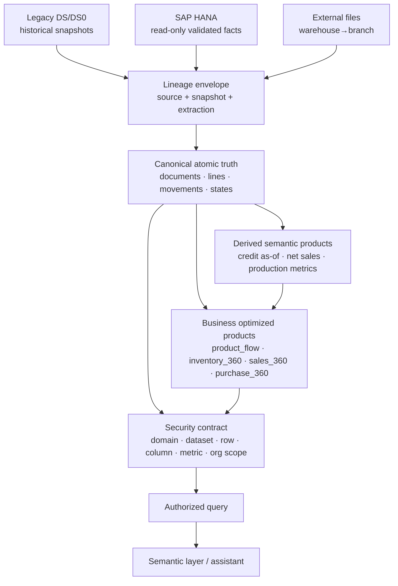

# TELCHI DATA LAKE — CANONICAL MODEL & LINEAGE V1

## A. Gate y alcance

**PASS — `TELCHI_DATALAKE_CANONICAL_MODEL_AND_LINEAGE_V1_PASS`**

Este gate consume y reconcilia, sin rehacerlos:

- `TELCHI_HISTORICAL_DATA_INVENTORY_V1_PASS`;
- `TELCHI_SAP_KNOWLEDGE_INVENTORY_V1_DEGRADED`.

El resultado es un modelo lógico, contrato de lineage, política temporal y fronteras
lógicas de data products. No crea Parquet productivos, no mueve ni elimina fuentes, no
implementa serving y no migra datos.

El PASS significa que las preguntas esenciales del gate tienen una respuesta de diseño
explícita, incluso cuando la respuesta es `UNKNOWN`, `PARTIAL` o `PROPOSED`. Los ocho
gaps bloqueantes se conservan como restricciones para el gate físico; no se ocultan ni se
resuelven inventando equivalencias.

### Contexto y autoridad

```text
ENTITY=TELCHI
DOMAIN=DATA_LAKE TRANSVERSAL SOBRE VENTAS, STOCK, COMPRAS, PRODUCCIÓN Y CRÉDITO
STAGE=INVESTIGATION
SOURCES=LEGACY_DS + SAP_HANA + EXTERNAL_FILES
USER=administrator / administrators
SCOPE=ALL (domains, rows, columns, metrics)
SAP_POLICY=READ_ONLY
```

Fuentes principales:

- `docs/TELCHI_HISTORICAL_DATA_INVENTORY_V1.md`;
- `docs/TELCHI_SAP_KNOWLEDGE_INVENTORY_V1.md`;
- CSV y JSON de sus respectivas carpetas de validación.

El inventario SAP conserva: 116 gates, 79 objetos, 31 relaciones, 26 reglas, 19
métricas, 10 mappings histórico↔SAP y 18 gaps. El histórico conserva 706 archivos,
696 Parquet, 25.823.339 filas de footer y sus familias/schemas/calidad.

---

## B. Respuesta ejecutiva

| Pregunta del criterio | Respuesta V1 |
|---|---|
| Entidades canónicas | 51 entidades evaluadas: 25 `CORE_V1`, 5 `CORE_LATER`, 12 `REFERENCE`, 7 `SPECIALIZED`, 2 `OUT_OF_SCOPE`. |
| Granularidad | Está explícita por entidad en `canonical_entities.csv` y `canonical_grain.csv`; no se usa una granularidad implícita por tabla SAP. |
| Autoridad de origen | SAP es primario para hechos operacionales SAP validados; legacy es histórico para sus ventanas observadas; no se asume fecha de corte silenciosa. |
| EVENT vs SNAPSHOT | Eventos atómicos, estados, referencias y derivados son categorías distintas; la matriz está en la sección D y CSV. |
| Doble conteo | Cada snapshot conserva `source_snapshot_at`; se selecciona un corte declarado y una identidad nativa fuerte. Nunca se concatenan familias mensuales por defecto. |
| Legacy↔SAP | Crosswalk versionado con `canonical_id`, native IDs, vigencia, confianza, evidencia y política de colisión. Mapping no cerrado queda `UNKNOWN/PARTIAL`. |
| Trazabilidad | Envelope de lineage obligatorio; para SAP permite `ObjType`, `DocEntry`, `LineNum`, `TransNum`, `WhsCode`, `ItemCode` cuando aplican. |
| Atomic vs business | Los hechos mínimos son atomic; `product_flow`, `product_360`, `inventory_360`, `sales_360` y `purchase_360` son derivados denormalizados. |
| Autorización futura | Cada product declara dominio, dimensión organizacional, columnas/métricas sensibles y agregación cross-scope. Filtros ocurren antes de retrieval. |
| Gaps físicos | 8 bloqueantes, 8 no bloqueantes y 2 fuera de alcance; todos están clasificados en `blocking_gaps.csv`. |

---

## C. Modelo canónico

### C.1 Clasificación de entidades

- **`CORE_V1` (25):** `WAREHOUSE_BRANCH_MAPPING`, `SALE_DOCUMENT`, `SALE_LINE`,
  `CREDIT_NOTE`, `CREDIT_NOTE_LINE`, `INVENTORY_MOVEMENT`, `STOCK_SNAPSHOT`,
  `STOCK_CURRENT`, `PURCHASE_REQUEST`, `PURCHASE_ORDER`, `GOODS_RECEIPT`,
  `SUPPLIER_INVOICE`, `PURCHASE_RETURN`, `TRANSFER`, `TRANSFER_LINE`, `BOM`,
  `BOM_COMPONENT`, `PRODUCTION_ORDER`, `COMPONENT_CONSUMPTION`,
  `PRODUCTION_OUTPUT`, `PAYMENT`, `RECONCILIATION`, `CUSTOMER_CREDIT_STATE`,
  `USER`, `SALESPERSON`.
- **`REFERENCE` (12):** `PRODUCT`, `PRODUCT_GROUP`, `CUSTOMER`, `SUPPLIER`,
  `WAREHOUSE`, `BRANCH`, `DOCUMENT_TYPE`, `PAYMENT_TERM`, `CHANNEL`,
  `UNIT_OF_MEASURE`, `WAREHOUSE_ROLE`, `CURRENCY`.
- **`CORE_LATER` (5):** `EMPLOYEE`, `FORECAST_DEFINITION`, `FORECAST_LINE`,
  `MRP_PARAMETER`, `CREDIT_RISK_EVENT`.
- **`SPECIALIZED` (7):** `LOT_SERIAL`, `PRODUCT_TRACKING`, `CASH_TRANSACTION`,
  `BANK_DEPOSIT`, `GENERAL_LEDGER_ENTRY`, `SUPPLIER_EXPENSE`, `APPROVAL_EVENT`.
- **`OUT_OF_SCOPE` (2):** `PAYROLL_DETAIL`, `WHT_TRANSACTION_DETAIL`.

La clasificación de `PRODUCT`, `CUSTOMER`, `SUPPLIER` y `WAREHOUSE` como `REFERENCE`
no los hace secundarios: son dimensiones de identidad indispensables para los hechos
core. Sus atributos observados sí tendrán vigencia y extracción; no se proyectará el
estado actual hacia toda la historia.

### C.2 Entidades core y grano

| Entidad | Definición | Grano exacto | Natural key candidata | Surrogate | Semántica temporal |
|---|---|---|---|---|---|
| `WAREHOUSE_BRANCH_MAPPING` | Asignación organizacional | almacén × sucursal × intervalo no solapado | warehouse + branch + valid_from | sí | valid_from/valid_to |
| `SALE_DOCUMENT` | Cabecera de documento comercial | una instancia documental | source system + native id + type | sí | document/posting/due/system |
| `SALE_LINE` | Venta bruta atómica | una línea de documento de venta | source document + line | sí | document/posting/extraction |
| `CREDIT_NOTE` | Cabecera de NC | una instancia de NC | source system + native id + type | sí | document/posting/system |
| `CREDIT_NOTE_LINE` | Reducción/corrección atómica | una línea de NC | source document + line | sí | document/posting |
| `INVENTORY_MOVEMENT` | Movimiento físico/contable | una línea/evento de movimiento | transaction + line, con fallback declarado | sí | event/document/posting |
| `STOCK_SNAPSHOT` | Posición observada | producto × almacén × instante de corte | product + warehouse + snapshot_at | sí | snapshot_at obligatorio |
| `STOCK_CURRENT` | Estado corriente de fuente | producto × almacén × extracción corriente | product + warehouse + extracted_at | sí | current/system/extraction |
| `PURCHASE_REQUEST` | Requerimiento de compra | una línea de solicitud | source document + line | sí | document/requested/extraction |
| `PURCHASE_ORDER` | Compromiso de compra | una línea de orden | source document + line | sí | document/due/close |
| `GOODS_RECEIPT` | Entrada de proveedor | una línea de recepción | source document + line | sí | event/document/posting |
| `SUPPLIER_INVOICE` | Factura AP | una línea de factura | source document + line | sí | document/posting/due/system |
| `PURCHASE_RETURN` | Devolución al proveedor | una línea de devolución | source document + line | sí | event/document/posting |
| `TRANSFER` | Cabecera de transferencia | un documento de transferencia | source native id + type | sí | document/posting/system |
| `TRANSFER_LINE` | Transferencia atómica | una línea documental | source document + line | sí | event/document/posting |
| `BOM` | Padre y versión de fórmula | producto padre × versión/intervalo | product + version + valid_from | sí | valid_from/valid_to |
| `BOM_COMPONENT` | Requerimiento de componente | padre × componente × versión | bom + component + position | sí | valid_from/valid_to |
| `PRODUCTION_ORDER` | Orden de producción | una orden | source native id | sí | order/due/release/close |
| `COMPONENT_CONSUMPTION` | Consumo real | una línea de issue a orden | source document + line | sí | event/document/posting |
| `PRODUCTION_OUTPUT` | Salida real | una línea de receipt de producción | source document + line | sí | event/document/posting |
| `PAYMENT` | Cobro/pago | un documento de pago y dirección | source native id + direction | sí | event/document/posting |
| `RECONCILIATION` | Miembro de liquidación | reconciliación × documento miembro | reconciliation + native id + line | sí | reconciliation_date/as-of |
| `CUSTOMER_CREDIT_STATE` | Estado de crédito | cliente × fecha as-of | customer + as_of_date + semantic version | sí | as_of + system/extraction |
| `USER` | Identidad de usuario | usuario × versión observada | canonical user id | sí | validity/current extraction |
| `SALESPERSON` | Identidad comercial | vendedor × versión observada | canonical salesperson id | sí | validity/extraction |

Las definiciones completas, incluyendo fuentes y confianza, están en
`canonical_entities.csv`. Las relaciones de negocio (39) están en
`canonical_relationships.csv`; se conserva la cardinalidad `1:N` y se exige agregar
antes de joins que puedan producir fanout.

### C.3 EVENT, STATE, REFERENCE y DERIVED

- **`EVENT`:** `SALE_DOCUMENT`, `SALE_LINE`, `CREDIT_NOTE`, `CREDIT_NOTE_LINE`,
  `INVENTORY_MOVEMENT`, ciclo de compras, `TRANSFER`, producción, `PAYMENT`,
  `RECONCILIATION` y `APPROVAL_EVENT`.
- **`STATE`:** `STOCK_SNAPSHOT`, `STOCK_CURRENT`, `WAREHOUSE_BRANCH_MAPPING`,
  `MRP_PARAMETER`, `PAYMENT_TERM`, y las observaciones configuracionales.
- **`REFERENCE`:** producto, grupo, cliente, proveedor, almacén, sucursal, usuario,
  vendedor, vocabularios y roles.
- **`DERIVED`:** `CUSTOMER_CREDIT_STATE`, forecast/coverage/seasonality y métricas
  de producción o riesgo. Un derivado conserva referencias a sus hechos y
  `semantic_version`; no sustituye la fuente atómica.

`STOCK_SNAPSHOT` no es un movimiento. `STOCK_CURRENT` no es un histórico as-of.
`CUSTOMER_CREDIT_STATE` se puede reconstruir a fecha T; no se almacena solamente el
saldo actual.

---

## D. Sources of truth y coexistencia Legacy↔SAP

### D.1 Regla de autoridad

No se define un corte Legacy/SAP que no esté evidenciado. La regla es por concepto y
ventana:

1. **SAP_HANA:** primario para hechos SAP validados: documentos, movimientos OINM,
   stock OITW como estado corriente, compras, producción, transferencias, pagos y
   reconciliaciones.
2. **LEGACY_DS/DS0:** fuente histórica de las familias y ventanas observadas en el
   inventario: ventas legacy, movimientos agregados, compras y snapshots maestros.
3. **EXTERNAL_FILES:** autoridad observacional del mapping `almacenOficina.xlsx` hasta
   que exista una fuente temporal mejor.
4. **Derived:** ninguna derivación se convierte en autoridad; declara todas sus
   fuentes primarias y el `semantic_version`.

Los períodos se etiquetan como `LEGACY_OBSERVED_2012-2024` y
`SAP_VALIDATED_CURRENT_AND_HISTORICAL`; la transición es `NOT_DECLARED`. Las zonas de
overlap (por ejemplo 2022–2024) se reconcilian por crosswalk y lineage, no por una
fecha asumida.

### D.2 Crosswalk

El contrato de identidad usa:

```text
canonical_id (surrogate estable)
source_system
source_native_id
valid_from
valid_to
confidence
mapping_source
mapping_status
collision_policy
```

Se evalúan siete crosswalks: producto, cliente, proveedor, almacén, sucursal,
vendedor y usuario. El mapping actual está en `identity_crosswalk.csv`; sus siete
filas son **contratos**, no una afirmación de que todas las filas históricas ya estén
mapeadas. Las diez correspondencias de familias históricas a candidatos SAP se
preservan sin elevar `LIKELY`/`POSSIBLE`/`UNKNOWN` a `CONFIRMED` en
`historical_sap_crosswalk.csv`.

Reglas de colisión:

- no unir por nombre solamente;
- no reutilizar un native ID después de una identidad incompatible sin intervalo;
- no forzar una colisión: guardar `mapping_status=UNKNOWN` y razón;
- no duplicar filas para resolver un mapping ambiguo;
- cada join físico futuro debe poder volver a la fila del crosswalk y su evidencia.

### D.3 Warehouse→branch

`almacenOficina.xlsx` confirma 51 almacenes y 7 oficinas, sin almacenes sin oficina en
la observación, pero no aporta vigencia. El modelo usa
`WAREHOUSE_BRANCH_MAPPING(warehouse_id, branch_id, valid_from, valid_to, source,
confidence)`. La relación actual no se proyecta automáticamente hacia la historia.

---

## E. Política temporal y snapshots

### E.1 Campos temporales

| Campo | Uso | Obligatorio |
|---|---|---|
| `event_time` | Momento del evento operativo si existe | EVENT con timestamp confiable; si no, quality flag |
| `document_date` | Fecha declarada del documento | Documentos |
| `posting_date` | Fecha contable/contabilización | Hechos contabilizados cuando existe |
| `due_date` | Vencimiento contractual/documental | Crédito, AP y documentos que lo declaren |
| `snapshot_date` | Fecha de corte de una posición | `STOCK_SNAPSHOT` y snapshots legacy |
| `extraction_time` / `source_extracted_at` | Momento de lectura de fuente | Todos los futuros productos |
| `valid_from`, `valid_to` | Vigencia de identidad/configuración/mapping | Dimensiones versionadas y estados configurables |
| `system_time` | Cuándo el sistema registró/cambió el hecho | Si está disponible; no se sustituye por business date |
| `as_of_date` | Corte semántico para estado derivado | `CUSTOMER_CREDIT_STATE` y métricas as-of |

El timestamp no disponible no se inventa. Se conserva la fecha disponible, un
`temporal_quality` y el tipo de limitación.

### E.2 Tipos de fuente temporal

- **`APPEND_ONLY_EVENT`:** OINM y hechos SAP atómicos. Reversiones y cancelaciones
  son hechos o estados trazables; no se borran ni se suman como snapshots.
- **`PERIOD_SNAPSHOT`:** `movProduct`, `saleProduct`, `saleSB1Product`, `purchase`,
  `purchaseExpense`, `cash`, `cuentasxCobrar`, `productTracking`, `paymentB1`,
  `reconB1`, `ncB1Product` y `movProductSB1` como extractos históricos. El tipo de
  fuente no cambia el grano canónico: por ejemplo `movProductSB1` apunta a eventos,
  pero sus archivos son observaciones repetibles.
- **`FULL_SNAPSHOT`:** maestros legacy observados (`product`, `productSB1`,
  `clientSB1`, `wareHouseSB1`). Se usan como observaciones fechadas, no como
  historia completa.
- **`CURRENT_STATE`:** OITW y parámetros/configuración actuales. No se backdatean.
- **`DERIVED_SNAPSHOT`:** stock/credit/coverage calculados a un corte, con fuentes y
  versión semántica explícitas.

La matriz de 16 políticas está en `snapshot_policy.csv`.

### E.3 Deduplificación temporal

Dos registros se clasifican así:

- **`SAME_EVENT`:** mismo `source_system`, documento/transacción nativo, línea,
  tipo y semántica, observado en distintos snapshots.
- **`UPDATED_EVENT`:** misma identidad nativa, atributos/document state cambiados;
  se conserva la versión de observación y el orden de extracción.
- **`NEW_SNAPSHOT_VERSION`:** misma posición lógica con nuevo `snapshot_at`, sin
  pretender que sea otro evento.
- **`TRUE_DUPLICATE`:** misma identidad, mismo snapshot y mismos valores, tras
  normalización; se deduplica con auditoría.
- **`UNKNOWN`:** clave débil, colisión o grano no demostrable; se conserva y se
  excluye de sumas canónicas hasta resolución.

`__index_level_0__` nunca es clave de negocio. `DocEntry+ItemCode` y
`TransNum+DocLineNum+ItemCode+Warehouse` son candidatos diagnósticos, no contratos
universales. Las 181.384 colisiones de la segunda familia quedan bajo `UNKNOWN` hasta
reconciliación.

---

## F. Lineage contract

Cada futura fila o agregado debe llevar un envelope de lineage. Los perfiles y sus
campos `REQUIRED`, `OPTIONAL` o `NOT_APPLICABLE` están en `lineage_contract.csv`.

### F.1 Reglas comunes

`source_system`, `source_table_or_dataset`, `source_native_key`, `source_extracted_at`,
`ingested_at`, `transformation_version` y `semantic_version` son obligatorios en
productos futuros. Para legacy snapshot son obligatorios `source_file` y
`source_snapshot_at`. Para eventos son obligatorios el identificador documental o
transaccional que corresponda; si la fuente no lo tiene, se conserva una calidad de
lineage explícita.

### F.2 SAP traceability

Cuando aplica, el futuro envelope puede contener:

```text
source_system = SAP_HANA
sap_objtype
sap_docentry
sap_linenum
sap_transnum
sap_whscode
sap_itemcode
```

La clase de traza es:

- `FULL_DOCUMENT_TRACE`: documento y línea nativos disponibles, por ejemplo
  OINV/INV1, OPOR/POR1, OPCH/PCH1, OWTR/WTR1, IGE1/IGN1.
- `PARTIAL_TRACE`: se conoce documento o movimiento, pero faltan una línea, una
  relación o una dimensión; por ejemplo equivalencias históricas legacy↔SAP y
  algunos movimientos enriquecidos.
- `AGGREGATE_ONLY`: `movProduct` y otros agregados sin documento/transacción.

No se exige un campo SAP inexistente: los campos anteriores son opcionales por perfil
pero obligatorios cuando la entidad fuente los soporta.

### F.3 Versiones semánticas y métricas

Toda métrica derivada declara:

```text
metric_name
semantic_version
definition
valid_from
deprecated_at
source_contract
```

`coverage_days`, `production_variance`, `credit_risk_class`, `seasonality_class` y
las clasificaciones `EXACT/OVER/UNDER/PARTIAL/ZERO` son derivados, no hechos fuente.
El número histórico no se reinterpreta silenciosamente si cambia la definición.

---

## G. Ventas, compras, producción y crédito

### Ventas

- `SALE_LINE` representa venta bruta.
- `CREDIT_NOTE_LINE` representa reducción/corrección y permanece separada.
- `net_sale` es métrica derivada: gross sale menos credit notes según regla y corte.
- estado de factura/documento y estado de pago son dimensiones/entidades distintas.
- `PAYMENT` y `RECONCILIATION` no se infieren de `PaidToDate` ni de un join ingenuo;
  SAP validó `OITR/ITR1` como autoridad de liquidación.
- `saleProduct` y `saleSB1Product` son observaciones históricas, no hechos
  adicionales por archivo.

### Compras

El ciclo lógico es:

```text
PURCHASE_REQUEST → PURCHASE_ORDER → GOODS_RECEIPT → SUPPLIER_INVOICE → PURCHASE_RETURN
```

Las cinco entidades son independientes y el data product `purchase_cycle` las une
por `BaseEntry/BaseType` cuando existe. La evidencia SAP validó predominantemente
invoice-first: OPOR/POR1→OPCH/PCH1→OPDN/PDN1, además de PO→GR directo. El ciclo no
autoriza fanout de importes: se agrega por línea/documento antes de enriquecer.

### Producción y BOM

`BOM/BOM_COMPONENT` separa fórmula vigente; `PRODUCTION_ORDER` y `WOR1` conservan
la receta de la orden; `COMPONENT_CONSUMPTION` usa IGE1 como consumo real;
`PRODUCTION_OUTPUT` usa IGN1 como output real. Las categorías `EXACT`, `OVER`,
`UNDER`, `NOT_CONSUMED`, `PARTIAL` y `ZERO` son métricas derivadas sobre estos
hechos. La relación producción→despacho no se declara FK: cuando sea heurística
llevará confianza y lineage parcial.

### Crédito

Se separan:

```text
SALE_DOCUMENT / CREDIT_NOTE
PAYMENT
RECONCILIATION
credit limit/configuration (reference/config)
CUSTOMER_CREDIT_STATE (derived as-of)
CREDIT_RISK_EVENT (later/specialized)
```

Así se puede reconstruir el estado en fecha T usando fecha de reconciliación,
estado documental, vencimiento y NC; no solo el saldo actual.

### MRP y forecast

`MRP_PARAMETER`, `FORECAST_DEFINITION` y `FORECAST_LINE` están en `CORE_LATER`.
Se distinguen `CONFIGURED`, `OBSERVED`, `INFERRED` y `UNKNOWN`. Una configuración
no se convierte en comportamiento ni en demanda observada. La falta de historial de
ejecución no bloquea el núcleo de ventas/stock/compras, pero sí debe permanecer en el
contrato si el siguiente gate decide materializar estos productos.

---

## H. Data product boundaries

### H.1 Atomic truth

Los products atomic preservan hechos con mínima interpretación:

`product_master`, `customer_master`, `supplier_master`, `warehouse_master`,
`warehouse_branch_mapping`, `sales_documents`, `sales_lines`, `credit_notes`,
`inventory_movements`, `stock_snapshots`, `stock_current`, `purchase_requests`,
`purchase_cycle` (como conjunto de hechos, no una fila mágica), `bom`,
`production_orders`, `production_consumption`, `production_output`,
`warehouse_transfers`, `payments`, `reconciliations` y `customer_credit_state`.

`purchase_cycle` tiene una vista business sobre cinco entidades atomic; no reemplaza
sus tablas lógicas de hechos.

### H.2 Business/denormalized

Se proponen 29 candidatos en `data_product_candidates.csv`. Los principales
read models son:

- `product_flow`: producto + eventos de venta/movimiento/transferencia;
- `product_360`: producto, identidad, stock, flujo y compra;
- `inventory_360`: stock, movimientos y organización de almacén;
- `sales_360`: documento/línea, cliente, vendedor, crédito y pago;
- `purchase_360`: ciclo, proveedor y efecto de stock.

Estos productos son derivados, no otra fuente de verdad. Justificación de performance:
preguntas conversacionales como “flujo del producto X por almacén”, “qué ventas están
abiertas y vencidas” o “qué compras recibidas explican el stock” no deben reconstruir
decenas de joins cada vez. La ruta conceptual es:

```text
atomic truth → business optimized product → DuckDB/query engine → semantic layer → authorized query
```

No se define todavía carpeta, Parquet, partición, compaction, scheduler ni refresh.

### H.3 `movProductSB1` y `movProduct`

- `movProductSB1` **no** es entidad atómica canónica. Es precursor de `product_flow`
  o `inventory_360`, con movimiento atomic abajo y dimensiones enriquecidas arriba.
- `movProduct` es una evidencia agregada por producto × almacén × período/snapshot.
  Es `PERIOD_SNAPSHOT` de una posición/agregado, no debe mezclarse con
  `INVENTORY_MOVEMENT` ni con `movProductSB1`.

---

## I. Seguridad preparada

Durante este gate `administrator/administrators` tiene acceso total. No se aplican
filtros al análisis. Aun así, cada candidate declara en `security_contract.csv`:

```text
security_domain
organizational_scope_dimension
sensitive_columns_or_metrics
cross_scope_aggregation_allowed
gate_access
```

Hay 9 dominios: `inventory`, `sales`, `purchases`, `production`, `credit`, `finance`,
`hr`, `users`, `configuration`.

La dimensión de alcance debe estar antes de retrieval, no después de generar una
respuesta. Ejemplos:

- movimientos: `warehouse_id`;
- ventas: `branch_id`, `salesperson_id`, `channel`;
- compras: `supplier_id`, `branch_id`;
- crédito: `customer_id`, `portfolio_id`;
- producción: `warehouse_id/plant_id`.

El contrato soporta simultáneamente restricciones por `domain`, `dataset`, `metric`,
`column`, `row` y `organizational_scope`. La ausencia de autorización histórica se
expone como gap; no se simula un histórico de permisos.

---

## J. Gaps clasificados

De los 18 gaps del inventario SAP:

- **8 bloqueantes para el siguiente diseño físico:** GAP-001, 002, 003, 004, 010,
  012, 017, 018.
- **8 no bloqueantes para el modelo físico V1:** GAP-005, 006, 007, 008, 009,
  011, 013, 016.
- **2 fuera del alcance inicial:** GAP-014 (nómina detallada) y GAP-015 (WHT
  transaccional detallado).

“Bloqueante” significa que el gate físico debe expresarlo mediante columnas de
lineage, vigencia, calidad, cuarentena o trazabilidad parcial; no significa que se
pueda completar con una suposición. El detalle operativo, prioridad y acción está en
`blocking_gaps.csv`.

No se ejecutaron consultas SAP nuevas: la evidencia existente alcanza para aprobar
los contratos lógicos y el coste/beneficio de nuevas consultas no es necesario para
responder las diez preguntas esenciales. Si el gate físico necesita cerrar una de
estas incógnitas, la consulta debe ser puntual y registrarse con `validation_id`,
pregunta, tablas, hash/path SQL, filas y efecto.

---

## K. Diagrama lógico



Relaciones principales: venta/NC → cliente/producto → movimiento; compra → recepción
→ factura; BOM → orden → consumo/output; transferencia → dos movimientos contables;
pago/reconciliación → estado crediticio as-of. El detalle de 39 relaciones queda en
CSV para evitar un diagrama gigante de 79 tablas SAP.

---

## L. Decision log

Las 17 decisiones están en `decision_log.csv`. Las más importantes son:

- `DEC-001`: `movProductSB1` es business precursor, no atomic.
- `DEC-002`: `movProduct` es agregado de período/snapshot.
- `DEC-003`: gross sale, NC, net sale y payment state son conceptos separados.
- `DEC-004`: purchase cycle sobre hechos independientes y links BaseEntry.
- `DEC-005`: clasificaciones de producción son métricas derivadas.
- `DEC-006`: transferencia es contable; no prueba logística física.
- `DEC-007`: credit state es as-of.
- `DEC-008`: no hay cutover Legacy/SAP inventado.
- `DEC-009/010`: crosswalk versionado y warehouse→branch temporal.
- `DEC-011/012`: snapshots no se concatenan y SAP trace es nullable por aplicación.
- `DEC-013/014`: security-before-retrieval y read models business.
- `DEC-015/016`: MRP/forecast y nómina/WHT no se convierten en hechos V1.
- `DEC-017`: semantic versioning para métricas.

Cada decisión incluye pregunta, alternativas, razón, evidencia, confianza e impacto.

---

## M. Validación reproducible

Artefactos bajo:

`investigation/validation/datalake_canonical_model_and_lineage_v1/`

- `build_outputs.py`: reconstruye los CSV y `summary.json` desde contratos declarativos.
- `canonical_entities.csv` (51), `canonical_grain.csv` (25),
  `canonical_relationships.csv` (39), `source_of_truth.csv` (31),
  `snapshot_policy.csv` (16), `lineage_contract.csv` (152 filas de campos),
  `historical_sap_crosswalk.csv` (10), `identity_crosswalk.csv` (7),
  `data_product_candidates.csv` (29), `security_contract.csv` (9),
  `blocking_gaps.csv` (18), `decision_log.csv` (17), `summary.json`.

`lineage_contracts=8` significa ocho perfiles de contrato; el CSV desglosa sus 152
combinaciones de campos y estados `REQUIRED`, `OPTIONAL`, `NOT_APPLICABLE`.

No contiene Parquet ni acceso a SAP. El siguiente gate podrá consumir estos contratos
para decidir columnas físicas, pero no debe reinterpretar los unknowns como joins.

---

## N. Recomendación para el siguiente gate

Diseñar el layout físico únicamente sobre este modelo aprobado, en este orden:

1. columnas base de atomic truth y envelope lineage;
2. columnas de vigencia, as-of, snapshot y quality/quarantine;
3. reglas de incrementalidad por tipo de fuente;
4. materialización de business products para las preguntas prioritarias;
5. pruebas anti-double-count y anti-fanout contra los baselines existentes;
6. security-before-retrieval sobre las dimensiones declaradas.

No avanzar desde este documento a Parquet productivo, particionado, compaction, DuckDB
serving, ingestión, scheduler o refresh incremental sin el gate físico explícito.

---

## O. Cierre operativo obligatorio

```text
HISTORICAL_INVENTORY_USED=YES
SAP_KNOWLEDGE_INVENTORY_USED=YES

SAP_ACCESSED=NO
SAP_ACCESS_PURPOSE=NONE
SAP_WRITE_COUNT=0

CANONICAL_ENTITIES=51
CANONICAL_RELATIONSHIPS=39
CORE_V1_ENTITIES=25
DATA_PRODUCT_CANDIDATES=29
SNAPSHOT_POLICIES=16
LINEAGE_CONTRACTS=8
IDENTITY_CROSSWALKS=7
SECURITY_DOMAINS=9

BLOCKING_GAPS=8
NON_BLOCKING_GAPS=8

PRODUCTION_PARQUETS_CREATED=0
SOURCE_FILES_MOVED=0
SOURCE_FILES_DELETED=0
DATALAKE_PHYSICAL_LAYOUT_CREATED=0

TELCHI_DATALAKE_CANONICAL_MODEL_AND_LINEAGE_V1_PASS
```
